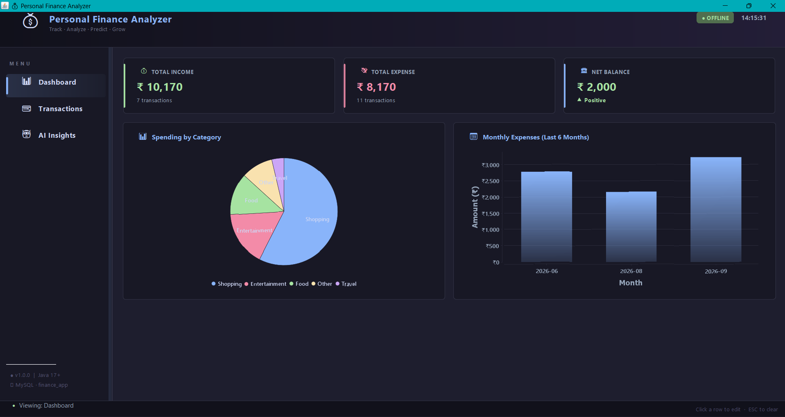
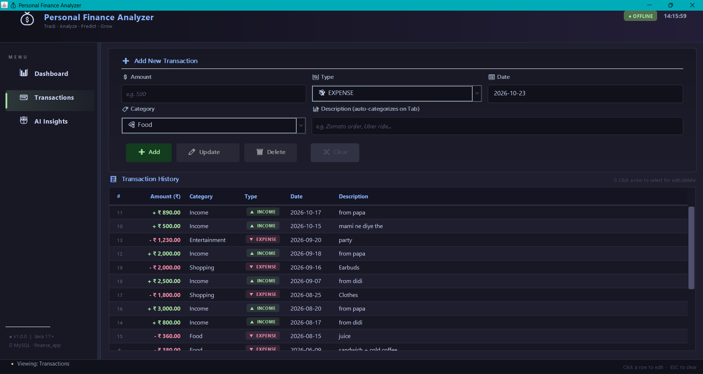
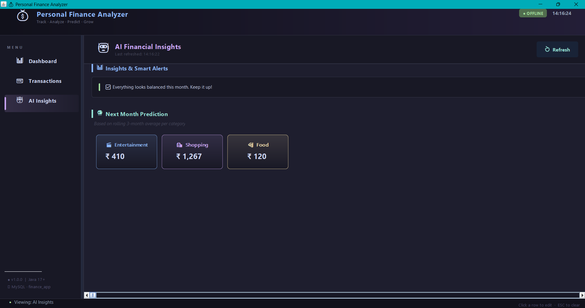

<div align="center">

# Personal Finance Analyzer

### Track · Analyze · Predict · Grow

A Java desktop application for managing transactions, visualizing spending, and generating practical, rule-based financial insights — wrapped in a polished dark interface.


[](LICENSE)

</div>

---

## Overview

**Personal Finance Analyzer** is a Java Swing desktop app that brings everyday money management into one place. Add and maintain income or expense transactions, review financial summaries, explore category-wise spending, and get lightweight alerts and budget estimates from your transaction history.

The interface uses a **Catppuccin Mocha-inspired dark theme**, custom Java `Graphics2D` styling, clear data tables, and JFreeChart visualizations. The application also includes a **Recruiter Demo Mode**: if MySQL cannot be reached, it can fall back to sample data stored in memory so the app remains demonstrable instead of crashing at startup.

## Screenshots

Add the three application screenshots to a `screenshots/` directory in the repository root using the filenames shown below. These paths are ready to use in GitHub Markdown.

### 1. Dashboard

See income, expenses, net balance, category breakdown, and monthly expense trends in one view.



### 2. Transaction Management

Add, update, delete, and review transactions using the two-row entry form and styled transaction history table.



### 3. AI Financial Insights

Review smart spending alerts and category-level next-month estimates based on a rolling three-month average.




## Features

### Dashboard and visual analytics

- **Financial summary cards** for Total Income, Total Expense, and Net Balance.
- A **balance trend indicator** to communicate whether the balance is positive or negative.
- **Spending by Category** pie chart, powered by JFreeChart.
- **Monthly Expenses** bar chart for a six-month spending overview.
- A consistent dark visual system with accent colors, custom drawing, and readable spacing.

### Transaction management

- Create, read, update, and delete income and expense records.
- Record transaction amount, type, category, date, and description.
- Use a compact, two-row form layout for transaction entry.
- Browse transaction history in a dark table with alternate row rendering.
- Auto-categorize supported descriptions using keyword rules when the description field is entered or updated as designed in the app.

### AI-inspired financial insights

The insights engine is **rule-based**. It uses keyword mapping and transparent calculations rather than claiming to be a trained machine-learning model.

- **Automatic categorization:** Maps description keywords to configured spending categories.
- **Spending anomaly alerts:** Flags spending that is more than **40% above the three-month baseline**.
- **Next-month prediction:** Estimates expenses by category using a rolling three-month average.
- **Refreshable insights:** Recalculate alerts and estimates as transaction data changes.

Forecasts are estimates based on historical data, not guarantees of future spending or financial advice.

## Recruiter Demo Mode

A desktop project should remain easy to evaluate even when the evaluator has not configured a local database. Personal Finance Analyzer is designed to handle that scenario gracefully.

When the MySQL server is unreachable, the app can switch to an **in-memory demo data source** populated with sample transactions. The Dashboard, Transaction Management, and AI Insights screens can then be explored without requiring MySQL to be running.

**Why this matters**

- The application can demonstrate its UI and core workflows on a recruiter’s machine.
- A database connection failure does not have to terminate the application.
- Sample data makes the dashboard, charts, and insights viewable immediately.

**Important:** Demo-mode records are held in RAM, not durable database storage. Changes made while using the fallback may disappear when the application closes. Use the MySQL-backed mode to verify persistent storage.

## Architecture

The application uses **Model–View–Controller (MVC)** to separate domain data, presentation, and user interaction. DAO classes isolate data-access operations, while the `DBConnection` Singleton centralizes the database connection. The demo engine provides an in-memory route when a live database is unavailable.

```text
                       User
                        |
                        v
                 +---------------+
                 | UI / View     |  Java Swing + AWT
                 +---------------+
                        |
                        v
                 +---------------+
                 | Controller    |  User actions / app logic
                 +---------------+
                        |
                        v
                 +---------------+
                 | DAO           |  Transaction data access
                 +---------------+
                        |
                        v
              +-----------------------+
              | DBConnection /        |
              | Demo Engine           |
              +-----------------------+
                    /           \
                   v             v
          +----------------+  +----------------+
          | MySQL 8.0      |  | In-memory RAM  |
          | Persistent     |  | Demo data      |
          | storage        |  | Temporary      |
          +----------------+  +----------------+
```

**Core data flow:**

```text
[UI] -> [DAO] -> [DBConnection / Demo Engine] -> [MySQL / RAM]
```

| Component | Responsibility |
|---|---|
| **Model** | Represents transactions and related financial data. |
| **View** | Renders forms, navigation, tables, summary cards, and charts. |
| **Controller** | Coordinates UI events and application operations. |
| **DAO** | Keeps data-access logic separate from Swing components. |
| **`DBConnection` Singleton** | Centralizes access to the configured MySQL connection. |
| **Demo Engine** | Supplies temporary sample data when the database is unavailable. |

## Technology Stack

| Technology | Usage |
|---|---|
| **Java 17+** | Core language and application logic |
| **Java Swing & AWT** | Desktop UI, layout, tables, and custom `Graphics2D` rendering |
| **Catppuccin Mocha-inspired palette** | Dark theme and UI accents |
| **MySQL 8.0** | Persistent transaction storage |
| **JDBC** | Java-to-MySQL connectivity |
| **JFreeChart 1.5.4** | Category pie chart and monthly expense bar chart |
| **MVC + DAO** | Separation of UI, coordination, and persistence concerns |
| **Singleton Pattern** | Centralized `DBConnection` access |

## Getting Started

### Prerequisites

For development and MySQL-backed usage, you will need:

- JDK **17 or newer**
- IntelliJ IDEA or another Java IDE
- MySQL Server **8.0**
- The dependencies configured by the project, including MySQL Connector/J and JFreeChart

MySQL is optional for exploring the app **only if the demo fallback is enabled and working**. Persistent transaction storage requires a reachable database and the correct schema.

### Option 1 — Run in IntelliJ IDEA

1. **Clone the repository.** Replace `OWNER/REPOSITORY` with your GitHub repository path.

   ```bash
   git clone https://github.com/OWNER/REPOSITORY.git
   cd REPOSITORY
   ```

2. **Open the project** in IntelliJ IDEA using **File → Open**.

3. **Configure Java 17+.** Set the Project SDK under **File → Project Structure**.

4. **Load the dependencies.** If the project contains a `pom.xml`, reload it as a Maven project. Otherwise, use the build/dependency configuration already present in your repository.

5. **Configure MySQL for persistent storage.** Start MySQL, create the database expected by the application, and apply the project's SQL schema or setup script. The UI currently displays `finance_app` as its database label; verify the actual database name and connection settings in `DBConnection`.

6. **Run the main class.** Locate the class containing `public static void main(String[] args)`, create a Run Configuration, and click **Run**.

7. **Verify both modes.** Confirm that MySQL-backed transactions persist. Then test the fallback in a development environment where MySQL is unavailable and verify the application remains open and loads sample data.

### Option 2 — Run the standalone JAR

1. Build the project using its configured build system. For a Maven project, run:

   ```bash
   mvn clean package
   ```

2. Locate the resulting JAR, usually under `target/` for Maven projects.

3. Run the packaged JAR using its actual filename:

   ```bash
   java -jar target/personal-finance-analyzer.jar
   ```

   The name above is an example; replace it with the JAR generated by your build. This command works when the JAR has a valid `Main-Class` manifest entry and its runtime dependencies are bundled or otherwise available. A plain JAR without dependencies included will need the project's documented classpath or packaging setup.

4. Configure MySQL for persistent storage, or use the in-memory demo fallback if it is enabled in the application.

**Windows tip:** Run the commands from PowerShell or Command Prompt. Check the installed Java version with `java -version`.

## Database Setup and Configuration

The app connects to MySQL through JDBC. Use the connection settings and initialization scripts included in the repository as the source of truth for the database URL, schema, username, password, and table definitions.

Recommended setup:

1. Start MySQL Server 8.0.
2. Create the database expected by the project (the UI label shows `finance_app`; confirm this in the code).
3. Run the project's SQL schema or database initialization script.
4. Configure the connection values used by `DBConnection`.
5. Test creating, editing, and deleting a transaction, then restart the app and verify that MySQL-backed records persist.

Do not commit production credentials to GitHub. Use local configuration or environment variables if the application's current connection code supports them; otherwise, consider moving credentials into a local configuration file excluded through `.gitignore`.

## Project Structure

The exact package layout depends on the repository. A typical structure for the described design could look like this:

```text
Personal-Finance-Analyzer/
├── src/
│   └── main/
│       ├── java/
│       │   ├── model/          # Transaction and domain models
│       │   ├── view/           # Swing screens and custom renderers
│       │   ├── controller/     # UI event handling and coordination
│       │   ├── dao/            # Database/data-source operations
│       │   ├── database/       # DBConnection and demo data source
│       │   └── analysis/       # Categorization, alerts, forecasting
│       └── resources/          # Optional icons and resources
├── screenshots/
│   ├── dashboard.png
│   ├── transactions.png
│   └── ai-insights.png
├── README.md
└── pom.xml                     # If the project uses Maven
```

Treat this tree as a documentation example; adjust it to match the actual repository rather than renaming working source packages just to match the diagram.

## Troubleshooting

| Problem | What to check |
|---|---|
| App does not start | Confirm JDK 17+ is installed and inspect the console output for the root exception. |
| MySQL connection fails | Verify the server is running, the URL/port and credentials are correct, and the expected schema exists. |
| JDBC driver error | Confirm MySQL Connector/J is included in the project's runtime dependencies. |
| JAR says `no main manifest attribute` | Configure the build to write the correct main class into the JAR manifest. |
| Chart classes are missing | Ensure JFreeChart is on the runtime classpath or bundled by the packaging configuration. |
| Edits disappear after closing | Check whether the app is in in-memory demo mode; RAM-backed data is temporary. |
| Insights look empty | Verify there are transactions for the relevant periods and that the data source has loaded successfully. |

## Contributing

Suggestions, bug reports, and pull requests are welcome.

1. Fork the repository and create a focused feature branch.
2. Keep UI, controller, analysis, and persistence responsibilities separated.
3. When changing database handling, test both MySQL mode and the demo fallback.
4. Include screenshots for visible UI changes and describe how you tested the change.
5. Open a pull request with a concise summary and reproduction steps for any fix.

## License

This project is licensed under the **MIT License**. You are free to use, copy, modify, merge, publish, distribute, sublicense, and/or sell copies of the software, provided that the copyright and permission notice are included with those copies.

The software is provided **"as is"**, without warranty of any kind. See the [`LICENSE`](LICENSE) file for the complete terms.

---

<div align="center">

**Personal Finance Analyzer** · Built with Java, Swing, JDBC, MySQL, and JFreeChart.

</div>
